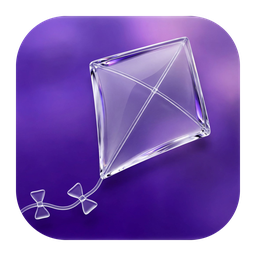
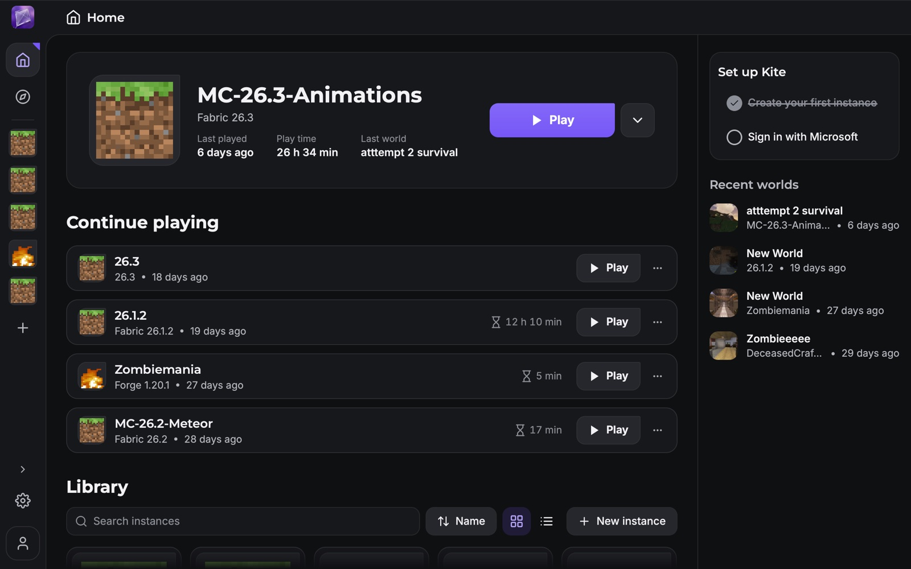

<p align="center">
  
</p>

<h1 align="center">Kite</h1>

<p align="center">
  A Minecraft launcher, built native: C++ and Qt Quick, not a web page in a window.
</p>

<p align="center">
  <a href="https://kiteclient.com">Website</a> ·
  <a href="https://kiteclient.com/download">Download</a> ·
  <a href="https://kiteclient.com/privacy">Privacy</a>
</p>

<p align="center">
  
</p>

Kite keeps every installation of Minecraft in its own instance, with its own
mods, worlds, resource packs and Java settings. A plain release, a 400-mod
pack and a snapshot sit side by side without touching each other.

## What it does

- Modpacks and mods from Modrinth, CurseForge, FTB, ATLauncher and Technic,
  searched and installed from inside the app.
- Fabric, Quilt, Forge and NeoForge, picked when you create an instance.
- A mod list per instance: switch mods off, check them all for updates, add
  more without opening a folder.
- Microsoft sign-in in your browser, several accounts, and a skin and cape
  editor.
- The right Java for each Minecraft version, downloaded when you don't have
  it, and memory on a slider.
- Imports MultiMC and Prism instance zips, Modrinth `.mrpack` files,
  CurseForge modpack zips and Technic packs.
- English and Turkish.

The first release is not out yet. Builds for macOS, Windows and Linux will be
on [kiteclient.com/download](https://kiteclient.com/download).

## Building

```sh
git submodule update --init
cmake --preset macos -DCMAKE_PREFIX_PATH=/path/to/Qt/6.x/macos
cmake --build build --config Debug
```

The Java launcher parts still target Java 7, which JDK 20 and newer refuse to
compile. Build with JDK 17 or older, for example by adding
`-DJava_JAVAC_EXECUTABLE=<jdk17>/bin/javac` to the configure line.

API keys are not part of the source tree. Without them, Microsoft sign-in,
CurseForge and screenshot uploads (Imgur) stay hidden. Log uploads still work:
without a key, Kite uses paste.ee's anonymous key, which has a smaller size
limit. Keep your own keys in a `CMakeUserPresets.json`, which git ignores:

```json
{
  "version": 8,
  "configurePresets": [
    {
      "name": "macos-local",
      "inherits": "macos",
      "cacheVariables": {
        "Kite_MICROSOFT_CLIENT_ID": "<Azure application ID>",
        "Kite_CURSEFORGE_API_KEY": "<CurseForge API key>"
      }
    }
  ]
}
```

## License

Kite is licensed under the [Apache License, Version 2.0](LICENSE). `COPYING.md`
lists the licenses of the code and assets it includes, and `NOTICE` says what
this fork changed.

Kite is a fork of [MeshMC](https://github.com/Project-Tick/MeshMC) by Project
Tick, which continues [MultiMC](https://github.com/MultiMC/Launcher). It is an
independent project, not affiliated with or endorsed by Project Tick, MultiMC,
Mojang or Microsoft. Minecraft is a trademark of Mojang Synergies AB.
